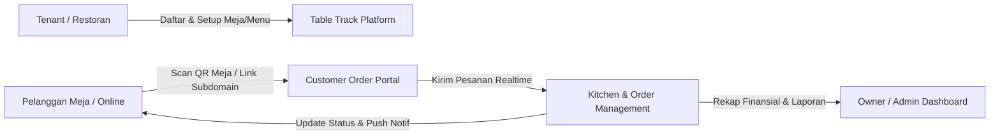
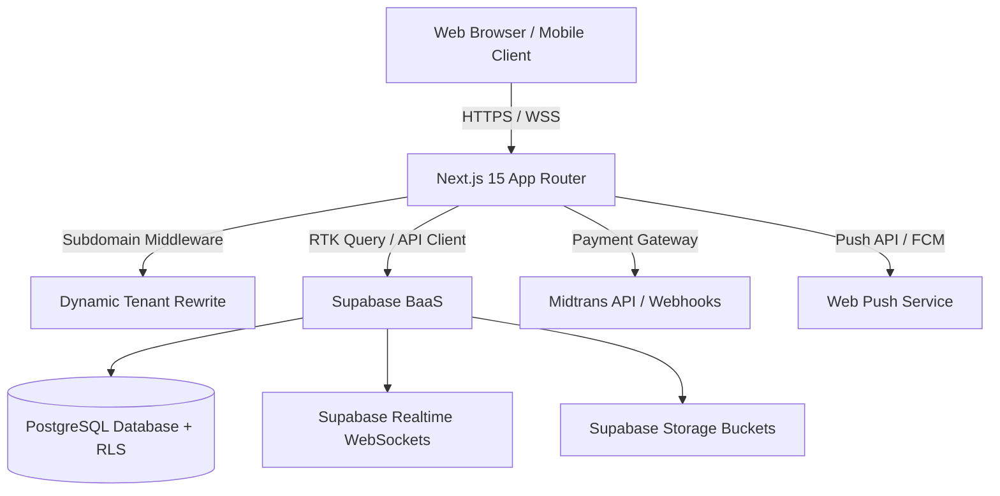
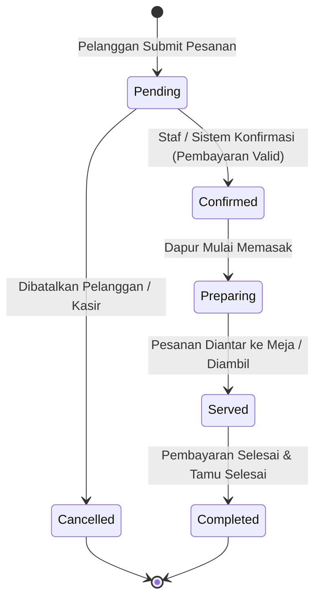
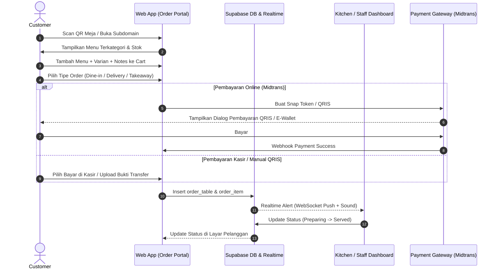
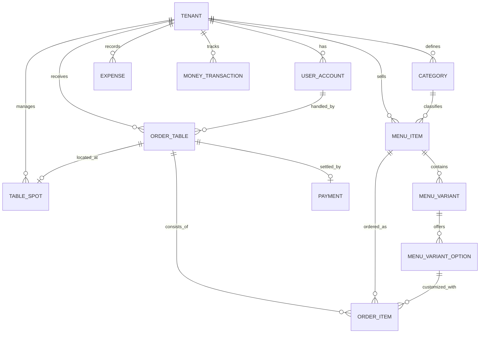
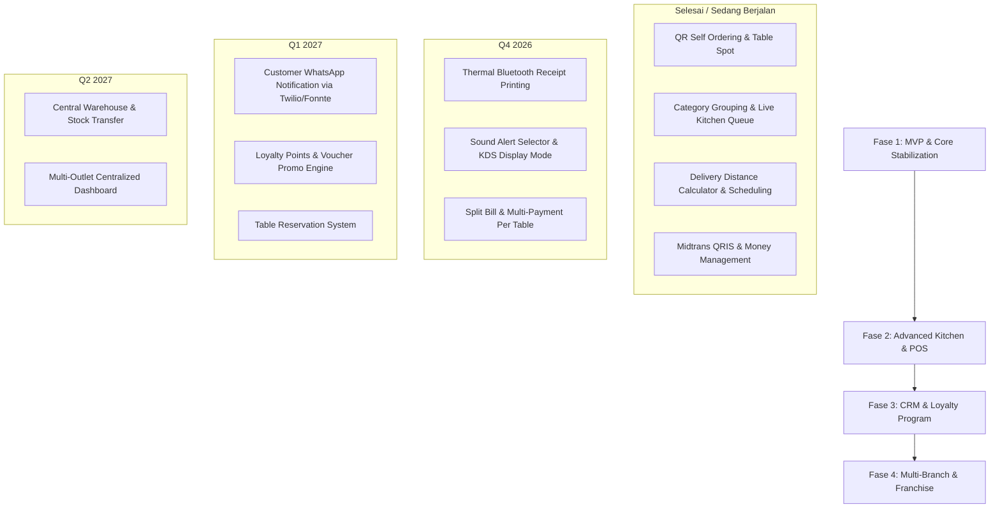

# Product Requirement Document (PRD): Table Track (Nata)
**Versi:** 1.0  
**Status:** Approved / Active Development  
**Target Platform:** Web (Desktop & Mobile Responsive), Progressive Web App (PWA)  
**Tech Stack:** Next.js (App Router), TypeScript, Tailwind CSS, Shadcn UI, Supabase (PostgreSQL, Realtime, Auth, Storage), Midtrans Payment Gateway, Web Push Notifications.

---

## 1. Executive Summary & Ringkasan Produk

**Table Track** (juga dikenal sebagai **Nata App**) adalah platform SaaS (*Software as a Service*) multi-tenant *all-in-one* yang dirancang khusus untuk industri F&B (Restoran, Kafe, dan Cloud Kitchen). 

Platform ini menjembatani interaksi antara **pelanggan (Customer)** dan **operasional restoran (Staff, Kitchen, Manager, Superadmin)** melalui sistem *contactless self-ordering* berbasis QR Code, pesanan pesan-antar (Delivery) dengan kalkulasi jarak otomatis, penjadwalan pesanan di muka (Pre-Order / Scheduled Order), manajemen meja interaktif, pelacakan kas & pengeluaran (Money Management), serta integrasi pembayaran digital (QRIS & Midtrans).

---

## 2. Latar Belakang & Problem Statement

### 2.1 Masalah yang Dihadapi Restoran Tradisional
1. **Waktu Tunggu Pelanggan:** Antrean panjang saat jam sibuk dan keterbatasan staf pelayan (*waiters*) memperlambat pengambilan pesanan.
2. **Human Error pada Pesanan:** Kesalahan pencatatan menu, varian makanan, atau catatan khusus (*notes/allergies*).
3. **Kompleksitas Pesanan Delivery Mandiri:** Restoran kesulitan menghitung ongkos kirim berdasarkan jarak GPS tanpa bergantung 100% pada pihak ketiga dengan komisi tinggi.
4. **Keterbatasan Pesanan Terjadwal (Pre-Order/Catering):** Tidak adanya sistem terpadu untuk menerima pesanan terjadwal untuk hari/jam tertentu.
5. **Pencatatan Keuangan Terpisah:** Pembukuan kas masuk dan pengeluaran harian (*expense*) tidak terintegrasi langsung dengan penjualan harian.

### 2.2 Solusi Table Track
- **QR Code Table Self-Order:** Pelanggan cukup memindai QR Code di meja menggunakan kamera smartphone tanpa perlu mengunduh aplikasi native.
- **Dynamic Subdomain Multi-Tenancy:** Setiap restoran memiliki alamat web mandiri (contoh: `misenary.nata.app` atau `misenary.localhost:3000`).
- **Support 3 Tipe Pesanan:** *Dine In*, *Takeaway*, dan *Delivery* lengkap dengan pemilihan pin lokasi di peta, kalkulasi radius jarak, dan ongkir otomatis.
- **Sistem Bulk/Scheduled Order:** Pelanggan dapat memesan makanan terjadwal untuk tanggal & jam tertentu.
- **Realtime Dashboard & Kitchen Display:** Notifikasi suara dan Web Push instan saat pesanan baru masuk.

---

## 3. Target Audiens & Persona Pengguna

| Role | Persona | Tanggung Jawab & Kebutuhan Utama |
|---|---|---|
| **Customer (Tamu)** | Pelanggan Restoran & Pemesan Online | Membuka menu digital, kustomisasi varian makanan, memilih metode pesan (*Dine-in, Takeaway, Delivery*), melakukan pembayaran (QRIS/Midtrans/Cash), serta memantau status pesanan secara *realtime*. |
| **Staff / Waiter / Cashier** | Karyawan Lapangan | Memverifikasi pembayaran manual (Cash/QRIS statis), mengonfirmasi pesanan, dan mengantar pesanan ke meja. |
| **Kitchen / Bar Staff** | Tim Dapur | Melihat antrean pesanan secara langsung (*Live Order Queue*), memproses item (*preparing*), dan menandai pesanan selesai (*served*). |
| **Manager / Admin Tenant** | Pemilik / Pengelola Restoran | Mengelola menu, kategori, meja, harga, stok, melihat laporan arus kas (*Money Management*), mengunggah QRIS, dan berlangganan paket (Free/Pro). |
| **Superadmin** | Tim Pengembang / Platform Owner | Memonitor seluruh tenant, aktivasi organisasi baru, manajemen lisensi, dan pemeliharaan sistem. |

---

## 4. Arsitektur Sistem & Tech Stack

- **Frontend & Server Framework:** Next.js 15 (App Router), React 19, TypeScript
- **State Management & Data Fetching:** Redux Toolkit (RTK Query / `flexible-querry`)
- **UI Components & Styling:** Tailwind CSS, Radix UI Primitives, Lucide Icons, Sonner Toaster
- **Backend & Database:** Supabase (PostgreSQL 14+, Row Level Security / RLS, Supabase Auth)
- **Realtime Sync:** Supabase Realtime Channels (Postgres CDC)
- **Payment Processing:** Midtrans Core API / Snap (QRIS, GoPay, Bank Transfer, Credit Card)
- **Routing:** Wildcard Subdomain Routing (`*.nata.app` via Next.js Middleware)
- **File & Media Storage:** Supabase Storage (Bucket: `assets/menu-images`, `assets/qris-images`, `assets/logos`)

---

## 5. Fitur Utama & Kebutuhan Fungsional

### 5.1 Portal Pemesanan Pelanggan (Customer Self-Ordering Portal)
- **Akses Cepat Meja:** Akses via scan QR Code meja (`/order/[slug]/[tableId]`) atau tautan pesan antar (`/order/[slug]`).
- **Grouping Menu & Kategori:** Menu dikelompokkan berdasarkan kategori (Makanan, Minuman, Dessert, dll.) dengan navigasi pill tab dan pencarian instan.
- **Kustomisasi Menu & Varian:**
  - Pilihan varian wajib/opsional (*required / optional*).
  - Penambahan harga dinamis per varian (*price add-on*).
  - Catatan khusus per item (*special instructions / allergies*).
- **Tiga Mode Pemesanan:**
  1. **Dine In:** Terikat otomatis dengan ID Meja fisik.
  2. **Takeaway:** Pelanggan mengambil langsung di gerai.
  3. **Delivery:** Pelanggan memasukkan alamat lengkap, memilih titik koordinat GPS di peta, kalkulasi jarak otomatis, dan penetapan ongkos kirim.
- **Penjadwalan Pesanan (Scheduled / Bulk Order):**
  - Opsi *Order for Today* atau *Schedule for Later Date*.
  - Pemilihan tanggal kalender dan slot jam pengiriman / pengambilan.
- **Integrasi Pembayaran Fleksibel:**
  - Pembayaran Online Otomatis via Midtrans (QRIS, E-Wallet, Virtual Account).
  - Pembayaran QRIS Manual (dengan unggah bukti transfer).
  - Pembayaran Tunai (Cash di kasir).
- **Live Order Status Tracking:** Pelanggan dapat memantau status pesanan secara live (`Pending` → `Confirmed` → `Preparing` → `Served/Delivered` → `Completed`).

---

### 5.2 Manajemen Pesanan & Kitchen Display (`/d/order-management`)
- **Live Realtime Order Board:** Tampilan antrean pesanan yang terupdate otomatis tanpa reload menggunakan Supabase Realtime WebSocket.
- **Filter Pesanan:**
  - *Today's Orders* (Pesanan hari ini).
  - *Scheduled Orders* (Pesanan masa depan / Pre-order terjadwal).
  - *All Orders* & Filter Status.
- **Lifecycle & Perubahan Status Pesanan:**
  - Tombol aksi cepat: *Confirm Order*, *Start Preparing*, *Mark Served*, *Complete*, dan *Cancel*.
  - Riwayat staf yang menangani (*Handled by*).
- **Notifikasi Audio & Visual:** Notifikasi suara dering dan Web Push ketika pesanan baru masuk dari meja manapun.

---

### 5.3 Manajemen Menu & Kategori (`/d/menu-management` & `/d/category`)
- **Pengelompokan Berdasarkan Kategori:**
  - Navigasi cepat dengan badge jumlah item per kategori.
  - Tampilan Section Grup yang dapat di-*expand* dan di-*collapse*.
  - Toggle antara *Grouped by Category* dan *Flat Table*.
- **Manajemen Gambar Multi-Photo:** Unggah foto menu dengan preview carousel dan indikator jumlah foto.
- **Manajemen Stok & Ketersediaan:** Pengaturan jumlah stok harian, penandaan *Out of Stock*, dan status *Available/Unavailable*.
- **Subscription Tier Protection:** Pembatasan maksimal 5 menu item untuk akun tier *Free*, dengan proteksi upgrade ke *Pro*.

---

### 5.4 Manajemen Meja & Generator QR Code (`/d/table-management`)
- **Pembuatan Meja Interaktif:** Penamaan meja/spot (contoh: Meja 01, VIP Room, Outdoor 3).
- **Auto-generated QR Code:** Pembuatan QR Code otomatis yang mengarah langsung ke domain/subdomain tenant bersangkutan.
- **Download QR Code:** Fitur unduh file QR Code berkualitas tinggi (.PNG) untuk dicetak dan ditempel di meja fisik.

---

### 5.5 Manajemen Arus Kas & Keuangan (`/d/money-management`)
- **Pencatatan Pemasukan (*Income*):** Tercatat otomatis dari pesanan yang selesai (*settled orders*) maupun input manual.
- **Pencatatan Pengeluaran (*Expense*):** Input biaya operasional (bahan baku, gaji staf, utilitas, sewa) lengkap dengan kategori dan deskripsi.
- **Ringkasan Kas Bersih (*Net Cashflow*):** Visualisasi total pemasukan, total pengeluaran, dan saldo kas bersih secara berkala.

---

### 5.6 Pengaturan Tenant & Branding (`/d/settings`)
- **Profil Usaha:** Nama restoran, slug subdomain, logo, alamat fisik, dan koordinat GPS (Latitude/Longitude).
- **Pengaturan Pembayaran Tenant:**
  - Unggah gambar QRIS statis milik restoran.
  - Nomor rekening bank dan instruksi transfer manual.
- **Radius & Delivery Calculation:** Penentuan titik awal toko untuk perhitungan jarak pesanan delivery.

---

### 5.7 Billing & Langganan SaaS (`/d/billing`)
- **Model Freemium:**
  - **Free Tier:** Maksimal 5 menu item, fitur standar.
  - **Pro Tier:** Unlimited menu items, unlimited QR table, dukungan pesanan terjadwal, analitik lengkap.
- **Automated Recurring / One-time Checkout:** Terintegrasi langsung dengan Midtrans Payment Subscription / Webhook.

---

## 6. Diagram Alur & State Machine

### 6.1 State Machine Pesanan (Order Lifecycle)

### 6.2 Alur Pemesanan Self-Order Pelanggan

---

## 7. Model Data & Skema Database Utama

### 7.1 Daftar Entitas Kunci
1. **`tenant`**: Identitas bisnis/restoran (`id`, `name`, `slug`, `subscription_tier`, `latitude`, `longitude`, `qris_image_url`).
2. **`user_account`**: Akun pengguna sistem (`id`, `email`, `role: superadmin | admin | manager | staff`, `tenant_id`).
3. **`table_spot`**: Meja fisik di restoran (`id`, `name`, `qr_code_url`, `is_active`, `tenant_id`).
4. **`category`**: Kategori menu (`id`, `name`, `sort_order`, `is_active`, `tenant_id`).
5. **`menu_item`**: Item makanan/minuman (`id`, `name`, `price`, `stock`, `is_available`, `image_url`, `category_id`, `tenant_id`).
6. **`menu_variant` & `menu_variant_option`**: Varian opsional/wajib dan penambahan harga.
7. **`order_table`**: Header transaksi pesanan (`id`, `order_number`, `type`, `status`, `scheduled_for`, `delivery_address`, `delivery_fee`, `total_amount`, `handled_by`, `table_id`, `tenant_id`).
8. **`order_item`**: Rincian item yang dipesan (`id`, `order_id`, `menu_item_id`, `option_id`, `qty`, `unit_price`, `notes`).
9. **`payment`**: Transaksi pembayaran (`id`, `order_id`, `method: qris | cash | card | online`, `status`, `amount`, `midtrans_id`).
10. **`expense` & `money_transaction`**: Pembukuan arus kas masuk/keluar.

---

## 8. Persyaratan Non-Fungsional (NFR)

### 8.1 Keamanan & Multi-Tenancy (Row-Level Security)
- **Isolasi Data Antar-Tenant:** Setiap tabel memiliki kolom `tenant_id` yang divalidasi ketat oleh PostgreSQL RLS (*Row Level Security*). Tenant A tidak dapat melihat data Tenant B dalam kondisi apapun.
- **Role-Based Access Control (RBAC):** Hak akses dibedakan untuk `superadmin`, `admin`, `manager`, `staff`, dan `customer`.
- **Proteksi API:** Validasi *secret token* pada Webhook Midtrans dan otentikasi JWT Supabase.

### 8.2 Performa & Keandalan
- **Latency Rendering:** Pemanfaatan Next.js Server Components dan caching cerdas untuk waktu muat menu < 1.5 detik pada jaringan 4G.
- **Realtime Latency:** Waktu propagasi notifikasi pesanan baru dari pelanggan ke layar dapur < 500ms via Supabase WebSocket.
- **Mobile First Experience:** Tampilan customer portal dioptimalkan untuk ukuran layar smartphone (320px - 480px) dengan target sentuh (*tap target*) minimal 44px.

---

## 9. Rencana Pengembangan & Roadmap

